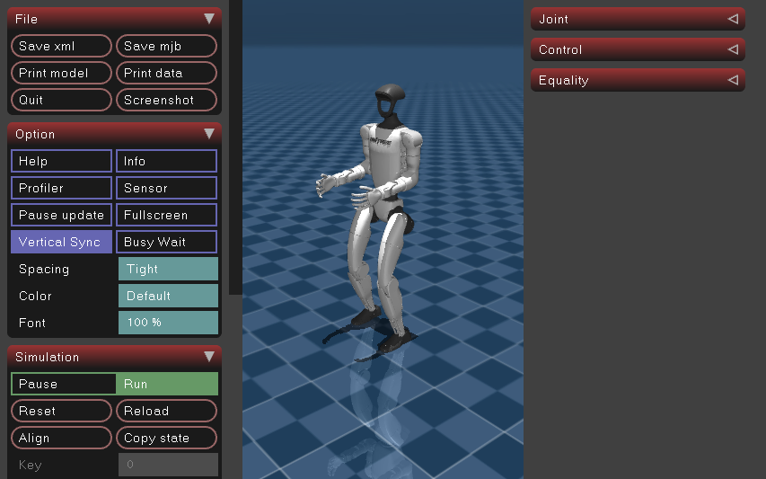
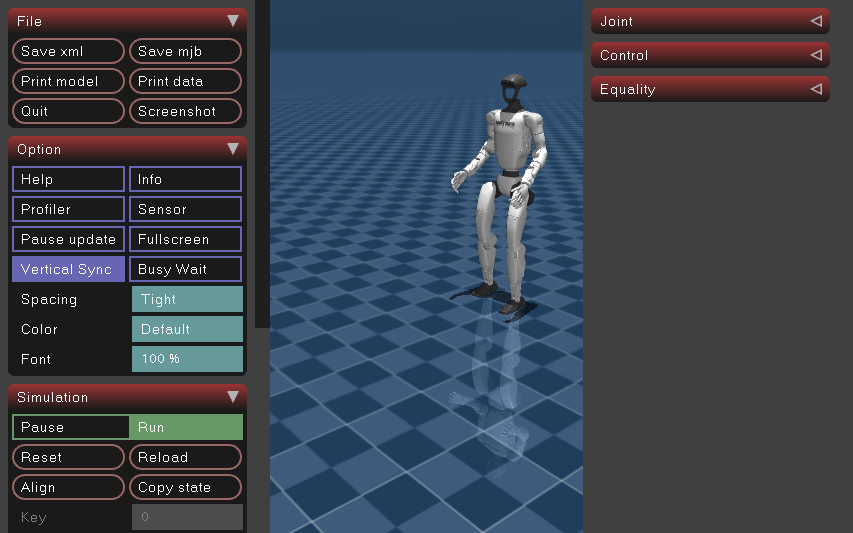
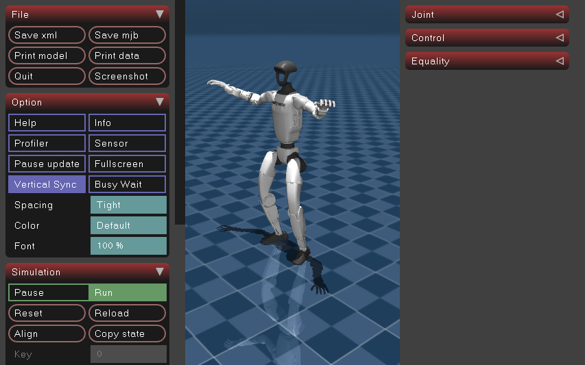

# 官方 MuJoCo 上的实机部署框架与策略验证

验证日期：2026-10-26。本文对应当前工作区的模型和配置。

`g1_real` 已通过原生实机后端驱动官方浮动 G1 连续行走：60 秒、3,000 次策略控制，仿真时间推进 59.978 秒，骨盆最低高度 0.754 米，最大倾角 0.076 弧度（约 4.4°）。外部 Dance 也已连续运行 145 秒，参考帧从 0 播放至 6,573，完成全部 6,574 帧；H2H 修复后通过 45 秒动态参考试验。可复现的稳定路径还包括 ASAP locomotion、Unitree/AMO 切换、BeyondMimic 的 Dance/Violin/Waltz、ASAP 的 CR7/robomimic 组合过渡，以及指定 seed 动作的 tracker。最终代码下，独立 Jump、独立 CR7、kongfu 和 KungfuBot2 的连续稳定运行仍未通过；TWIST、full-ASAP 和 H1 的前提缺口分别列于下表。这里的“部署”均指本次官方仿真闭环。

## 运行入口与准备

新增入口为 [scripts/run_unitree_policy.py](../scripts/run_unitree_policy.py)。它自行启动和清理官方 C++ 仿真器与可选 Xvfb，不需要另外启动 `run_unitree_mujoco.py`。同一 DDS 域中应只运行本次试验的一套仿真器和控制器。

使用项目根目录和已有 `.venv`。官方源码、已编译二进制、SDK2、MuJoCo、GLFW 和 Xvfb 的本机位置及重新编译命令见 [官方 G1 C++ 仿真联调](unitree_mujoco.md#本机编译)。默认官方 checkout 为同级 `../unitree_mujoco`；其他路径用 `--repo` 指定。本次没有更改官方模型、检查点或子模块版本。

```bash
.venv/bin/python scripts/run_unitree_policy.py --headless -c g1_real \
  --duration 60 --command 0.3 0 0 \
  --summary logs/unitree_policy/unitree-walk60.json \
  --log logs/unitree_policy/unitree-walk60.jsonl \
  --simulator-log logs/unitree_policy/unitree-walk60-simulator.log \
  --screenshot logs/unitree_policy/unitree-walk60.png
```

`--headless` 在独立虚拟显示器中运行官方正常图形程序。若桌面 `DISPLAY` 工作正常，可省略它显示仿真窗口。运行时间从 SDK、模型加载和仿真复位完成后计算；初始化还会额外耗时数秒。按 Ctrl-C 会关闭本次仿真器、Xvfb，摘要记录为中断；完整流水线已经构造时，也会先发布阻尼指令。

### 实际部署路径

```text
ConfigManager → 原配置的 RlPipeline / Multi / LocoMimic
              → 原策略及关节名称适配器
              → UnitreeCppEnv → 原生 unitree_cpp → DDS → 官方 G1
```

启动器在配置的私有副本中作以下适配，物理机器人默认配置保持原值：

| 项目 | 本次运行值 |
| --- | --- |
| 环境 | `G1RealEnvCfg` / `UnitreeCppEnv`，`is_sim=False` |
| 机器人 | 官方 `unitree_robots/g1/scene_29dof.xml`，29 个执行器、浮动基座 |
| 网络 / DDS 域 | `lo` / `0` |
| 控制 / 状态 | `rt/lowcmd` / `rt/lowstate`，HG 消息 |
| 位置与速度反馈 | `rt/sportmodestate`，替代真机默认 `rt/odommodestate` |
| 策略频率 | 保留配置频率；原生命令周期相应设置 |
| 参考动作 / FK | 保留原配置的参考控制器和兼容的 FK 设置；关闭动作选择 GUI |
| 输入 | 默认脚本输入；可选键盘或 Unitree 遥控输入 |
| 开始时的世界坐标 | 不作 born-place 对齐，使用仿真世界反馈 |

对原本为 `MujocoEnv` 的 G1 配置，同一入口会替换环境后端；这不是新增同名 `*_real` 注册配置。`g1_dev` 的原始场景是 23-DoF，本入口使用官方 29-DoF 场景和对应原生 FK，避免让 23-DoF FK 接收 29 维反馈；适配后已通过 12 秒运行，原始 23-DoF 场景仍独立。H1 配置会被明确拒绝，避免误用 G1 身体。

### 初始化与通过条件

SDK 的 MotionSwitcher 在仿真中没有相应 RPC 服务，初始化可能等待约 5 秒；此时尚无平衡策略，机器人可能已倒地。启动器先加载整个部署流水线，暂时关闭启动样本的跌倒检查，再发布策略初始姿态目标，通过官方 BackSpace 复位，并要求 DDS 时间戳回到接近零且反馈为直立状态，随后开启跌倒检查并进入策略控制。

这套仿真初始化取代了物理机器人吊装状态下的 `prepare()`，测量期间没有焊接约束、弹力绳或外力支撑。不能用此前 `--suspended` 的关节测试代替本次平衡结果。当前官方构建覆盖了 GLFW 键盘回调，Space 暂停快捷键不可作为可靠的启动同步手段。

当前启动器按请求的墙钟时长运行。默认通过条件包括：足够推进的仿真时间、持续有效的 LowState、每个初始化及运行目标均为 29 维有限值、后端仍启用、骨盆高度不低于 0.3 米、基座倾角不超过 1.0 弧度，且策略目标更新间隔不超过 200 毫秒。仿真时间推进不足请求时长的约 90% 会判失败。`--min-height`、`--max-tilt` 和 `--stale-timeout` 可调；调宽阈值后的结果必须同时报告阈值，不能与默认结果混用。

目标间隔在每次发令和外层循环末尾检查，统计从正式控制开始，排除启动时的预置目标和复位等待。LowState/姿态采样位于外层步边界；保留的 reset/blend-out 恢复流程若进入内部渐入，内部每条目标检查间隔，但不逐条采样姿态。完整 Dance 和 H2H 的正常恢复路径已避免这段重复渐入。

原框架的 blend-in 可能在一次外层 `step()` 中执行数秒的内层控制；启动器会检查内层实际目标更新间隔，并避免结束后用压缩的控制帧追赶时间。因此外层步数、实际动作数和仿真秒数需要分别阅读，不能只用 `步数 × 20 毫秒` 推断执行时间。

退出码 `0` 表示通过这些运行条件；运行失败为 `1`，中断为 `130`。动作目标超配置位置限位的次数会记录，但启动器不替换原策略输出、不因此自动裁剪。运行通过证明的是本场景下的有限时长闭环，动作精度、长时间漂移和物理机器部署需要相应的独立证据。

## 输入与策略切换

`--command VX VY YAW` 是归一化摇杆输入，范围均为 `[-1,1]`。它们依次写入 `LeftY`、`LeftX`、`RightX`，再由各策略映射；不是统一的米/秒或弧度/秒指令。不同策略还可能反转横移/转向符号或要求步态开关。JSONL 中保存输入和实际反馈。

`--event '秒数:动作'` 可重复指定，时间相对本次控制开始：

| 事件示例 | 效果 / 边界 |
| --- | --- |
| `--event '5:axes:0.3,0,0'` | 5 秒时更改归一化摇杆值 |
| `--event '1:button:Left'` | 发送一次 Left 按下事件；ASAP locomotion 用于切换站立/行走状态 |
| `--event '5:[POLICY_MIMIC]'` | LocoMimic 从 locomotion 进入当前选中的 mimic |
| `--event '20:[POLICY_LOCO]'` | LocoMimic 返回 locomotion |
| `--event '3:[POLICY_SWITCH],NEXT'` | LocoMimic 选择下一 mimic；选择和开始播放是两步操作 |
| `--event '8:[POLICY_SWITCH],1'` | Multi 选择索引 1；按该流水线的延迟切换规则生效 |
| `--event '3:[MOTION_RESET]'` | 向流水线和策略发送动作重置；具体行为取决于策略 |
| `--event '3:[MOTION_FADE_IN]'` | 恢复已激活策略的参考播放；当前活跃平衡策略不再额外返回名义姿态重做 blend-in |

事件必须早于 `--duration`。解析通过只说明事件格式有效；命令是否有用由对应流水线/策略决定。脚本输入仅替换输入设备控制器，动作参考控制器及其回调仍走原框架路径。

ASAP locomotion 的行走测试需要开启步态：

```bash
.venv/bin/python scripts/run_unitree_policy.py --headless -c g1_asap_loco \
  --duration 30 --command 0.3 0 0 --event '1:button:Left' \
  --summary logs/unitree_policy/asap-walk30.json \
  --log logs/unitree_policy/asap-walk30.jsonl
```

多策略切换复现命令：

```bash
.venv/bin/python scripts/run_unitree_policy.py --headless -c g1_switch \
  --duration 30 --event '8:[POLICY_SWITCH],1' --event '20:[POLICY_SWITCH],0' \
  --summary logs/unitree_policy/unitree-amo-switch.json \
  --log logs/unitree_policy/unitree-amo-switch.jsonl
```

三类 LocoMimic 的复现命令如下；已选动作完成后是否自动返回由相应策略回调决定：

```bash
# Unitree locomotion → CR7 → 自动返回
.venv/bin/python scripts/run_unitree_policy.py --headless -c g1_locomimic \
  --duration 20 --event '5:[POLICY_MIMIC]' \
  --summary logs/unitree_policy/unitree-locomimic-cr7.json \
  --log logs/unitree_policy/unitree-locomimic-cr7.jsonl

# AMO → 选择 Violin → 播放 → 自动返回
.venv/bin/python scripts/run_unitree_policy.py --headless \
  -c g1_locomimic_beyondmimic_real --duration 25 \
  --event '2:[POLICY_SWITCH],NEXT' --event '5:[POLICY_MIMIC]' \
  --summary logs/unitree_policy/beyond-violin.json \
  --log logs/unitree_policy/beyond-violin.jsonl

# ASAP locomotion → 选择 robomimic → 播放 → 自动返回
.venv/bin/python scripts/run_unitree_policy.py --headless \
  -c g1_locomimic_asap_real --duration 30 \
  --event '2:[POLICY_SWITCH],NEXT' --event '5:[POLICY_MIMIC]' \
  --summary logs/unitree_policy/asap-robomimic.json \
  --log logs/unitree_policy/asap-robomimic.jsonl
```

BeyondMimic 组合的默认 mimic 是 Dance，选择一次 NEXT 为 Violin、两次为 Waltz。ASAP 组合默认 CR7，选择一次 NEXT 为 robomimic、两次为 kongfu；本次 kongfu 路径有跌倒记录，不能因同组合的 CR7/robomimic 通过就列为稳定。

外部 Dance 的参考控制器默认暂停，需要显式恢复播放。完整动作约有 6,574 帧，下例预留 145 秒并在 3 秒时开始播放；应检查 `controller_progress` 的 `timestep` 是否持续增加和到达末帧：

```bash
.venv/bin/python scripts/run_unitree_policy.py --headless \
  -c g1_beyondmimic_with_ctrl --duration 145 \
  --event '3:[MOTION_FADE_IN]' \
  --summary logs/unitree_policy/dance-full-fixed.json \
  --log logs/unitree_policy/dance-full-fixed.jsonl
```

H2H 动态参考的正式复现命令：

```bash
.venv/bin/python scripts/run_unitree_policy.py --headless -c g1_h2h \
  --duration 45 --event '3:[MOTION_FADE_IN]' \
  --summary logs/unitree_policy/h2h-resume-fixed.json \
  --log logs/unitree_policy/h2h-resume-fixed.jsonl
```

`--input keyboard` 使用原配置的 KeyboardCtrl 映射；原配置没有键盘控制器时使用默认映射。需要输入时应运行于可操作的桌面显示器，省略 `--headless`。私有 Xvfb 中的键盘监听不会直接收到另一个桌面显示器上的按键。原框架按键映射、释放时触发和各策略实际消费差异见 [启动控制手册](../RUN_GUIDE.md)。`--input unitree` 读取仿真发布的遥控数据，已验证中立值路径 20 秒；真实摇杆轴/按键还需要官方仿真启用摇杆并连接兼容设备，未由中立值试验覆盖。

## 当前闭环结果

数据来源为本工作区 `logs/unitree_policy/` 下的每次摘要和 JSONL，关键结果随 [持久化试验数据](data/unitree_policy_results_2026-10-26.json) 保存。下面按动作范围列出主要记录；历史失败也保留在数据中，用于区分修复前后。

遥测在联调中完善过：早期 `frame_drops` 统计外层控制工作耗时超过一个周期；当前版本统计实际目标更新间隔大于 1.5 倍周期，同时记录 `max_command_gap_s`，并按墙钟控制试验时长。早期 60 秒 Unitree 记录中的 20 次掉帧属于旧定义，不能与新定义直接相加或比较；跨版本比较优先使用墙钟/仿真时长、姿态、目标有效性和实际播放进度。

| 试验 | 状态 | 控制步数 / 仿真秒数 | 最低骨盆高度 / 最大倾角 | 证据 |
| --- | --- | --- | --- | --- |
| Unitree，归一化前进输入 0.3，15 秒 | 已验证稳定 | 750 / 14.978 | 0.754 米 / 0.0733 弧度 | `g1-first.json`、`g1-first.jsonl` |
| Unitree，同输入，60 秒 | 已验证稳定 | 3,000 / 59.978 | 0.754 米 / 0.0760 弧度 | `unitree-walk60.json`、`unitree-walk60.jsonl` |
| ASAP locomotion，站立 30 秒 | 已验证稳定 | 1,500 / 29.978 | 0.745 米 / 0.0549 弧度 | `asap-stand30.json`、`asap-stand30.jsonl` |
| ASAP locomotion，步态开关后前进 30 秒 | 已验证稳定 | 1,500 / 29.980 | 0.730 米 / 0.0741 弧度 | `asap-walk30.json`、`asap-walk30.jsonl` |
| Unitree → AMO → Unitree，30 秒 | 已验证稳定 | 1,500 / 29.982 | 0.693 米 / 0.2311 弧度 | `unitree-amo-switch.json`；Unitree 900 步、AMO 600 步 |
| AMO → Dance → AMO，35 秒 | 已验证稳定 | 1,750 / 34.984 | 0.662 米 / 0.5198 弧度 | `beyond-dance-transition.json`；AMO 876 步、Dance 874 步 |
| ASAP locomotion → CR7 → 自动返回，30 秒 | 已验证稳定 | 1,500 / 29.980 | 0.570 米 / 0.5428 弧度 | `asap-cr7-transition.json`；loco 1,275 步、CR7 225 步 |
| Jump_wose，最终版本计划 10 秒 | 闭环失败（动作结束后的姿态回落） | 248 / 4.978 | 0.567 米 / 1.1128 弧度 | `jump-final.json`；已到 140 帧、`flag_motion_done=True` 后跌倒 |
| 独立 CR7，最终版本计划 12 秒 | 闭环失败（动作结束后的姿态回落） | 431 / 8.660 | 0.421 米 / 1.0573 弧度 | `standalone-cr7-final.json`；已完成动作后跌倒，组合路径另有通过证据 |
| H2H，正式恢复参考播放，45 秒 | 已验证稳定（动态参考） | 2,236 / 44.984 | 0.564 米 / 0.4454 弧度 | `h2h-resume-fixed.json`；`motion_time` 从 0 前进到 20.605 秒，参考长度 7.667 秒、速度比 0.5 |
| KungfuBot2，早期计划 20 秒 | 历史闭环失败 | 405 / 8.082 | 0.486 米 / 1.0607 弧度 | `kungfubot2.json`；最终复测见后行 |
| Tracker，seed 索引 0，20 秒 | 已验证稳定 | 1,000 / 19.980 | 0.749 米 / 0.1426 弧度 | `tracker.json`；显式动作路径，3 秒发送动作重置 |
| Dance 外部 NPZ 的首帧参考保持，20 秒 | 已验证稳定（首帧保持） | 1,000 / 19.980 | 0.770 米 / 0.0871 弧度 | `beyond-dance-external.json`；未发送播放命令，不能视为 Dance 动作跟踪通过 |
| Dance 外部 NPZ，正式播放 145 秒 | 已验证稳定（完整动作） | 7,186 / 144.998 | 0.457 米 / 0.6947 弧度 | `dance-full-fixed.json`；参考 0 → 6,573，全部 6,574 帧；目标最大间隔 29.75 毫秒 |
| AMO → Violin → 自动返回，25 秒 | 已验证稳定 | 1,250 / 24.980 | 0.658 米 / 0.5076 弧度 | `beyond-violin.json`；Violin 525 步 |
| AMO → Waltz → 自动返回，30 秒 | 已验证稳定 | 1,500 / 29.980 | 0.683 米 / 0.4915 弧度 | `beyond-waltz.json`；Waltz 875 步 |
| ASAP locomotion → robomimic → 自动返回，30 秒 | 已验证稳定 | 1,500 / 29.976 | 0.643 米 / 0.5933 弧度 | `asap-robomimic.json`；robomimic 926 步 |
| ASAP locomotion → kongfu，最终版本计划 15 秒 | 闭环失败 | 512 / 10.314 | 0.270 米 / 0.8314 弧度 | `kongfu-final.json`；kongfu 控制 163 步、动作未完成，骨盆低于 0.3 米 |
| Unitree locomotion → CR7 → 自动返回，20 秒 | 已验证稳定 | 1,000 / 19.978 | 0.560 米 / 0.5978 弧度 | `unitree-locomimic-cr7.json` |
| `g1` 别名接入，12 秒 | 已验证稳定 | 597 / 12.002 | 0.759 米 / 0.0582 弧度 | `g1-alias.json` |
| 仿真配置别名 AMO → Dance，25 秒 | 已验证稳定 | 1,242 / 24.980 | 0.673 米 / 0.5030 弧度 | `loco-beyond-sim-alias.json`；Dance 892 步 |
| 仿真配置别名 ASAP → CR7 → 自动返回，20 秒 | 已验证稳定 | 993 / 19.998 | 0.569 米 / 0.5926 弧度 | `loco-asap-sim-alias.json`；CR7 最终 `flag_motion_done=True` |
| Tracker 仿真配置别名，seed 索引 0，15 秒 | 已验证稳定 | 743 / 14.988 | 0.743 米 / 0.1625 弧度 | `tracker-sim-alias.json`；帧 0 → 103，随后进入默认姿态模式 |
| Tracker 实机配置，当前版本正式复测，15 秒 | 已验证稳定（指定 seed） | 743 / 14.988 | 0.749 米 / 0.1787 弧度 | `tracker-progress-final.json`；参考到 103/103 末帧，默认姿态模式开启；目标最大间隔 26.75 毫秒 |
| ASAP locomotion → CR7 → 自动返回，当前版本 20 秒 | 已验证稳定（完整 CR7） | 992 / 19.982 | 0.565 米 / 0.5829 弧度 | `asap-cr7-progress-final.json`；CR7 `timestep=199`、`flag_motion_done=True`，返回 loco |
| Multi：AMO → Violin → Dance → Waltz，35 秒 | 已验证稳定（所列时段） | 1,738 / 34.986 | 0.680 米 / 0.5085 弧度 | `multi-beyond-hard-switch.json`；Violin 到 500 帧结束，Waltz 本次只到 487/850 帧 |
| `g1_dev`，29-DoF FK 适配后，12 秒 | 已验证稳定（官方 29-DoF 场景） | 597 / 11.992 | 0.759 米 / 0.0561 弧度 | `g1-dev-fk-fixed.json`；原始 23-DoF 场景不包含在此结论中 |
| KungfuBot2，播放恢复修复后复测 | 闭环失败 | 399 / 8.088 | 0.515 米 / 1.0211 弧度 | `kungfubot2-resume-fixed.json`；参考时间 8.039 秒、片段长度 6.967 秒，片段末端附近/之后稳定性未通过 |

入口验证已覆盖当前全部 20 个 G1 注册名称。通过项的动作范围以试验描述为准，尤其外部参考控制器默认暂停、部分 Multi 时段没有覆盖整段动作。后续复测需检查摘要的 `passed`、`stage`、`error`、`policy_steps`、`policy_progress_initial`/`policy_progress` 和 `controller_progress_initial`/`controller_progress`；`event_deliveries` 只证明事件送达，还需实际帧数/时间增长和完成状态证明消费结果。

历史初始化失败仍有明确记录：`h2h.json` 是修复前缺首帧 FK，`g1-dev-adapted29.json` 是 23-DoF FK 收到 29 维关节数组，两者均已修复并通过正式复测。H2H 的 `h2h-fk-fixed.json` 和外部 Dance 的 `beyond-dance-playback.json` 在旧恢复路径中重新混合到名义姿态后倒地；跳过重混合的诊断运行为定位问题提供依据。当前 H2H/Dance 结论分别以 `h2h-resume-fixed.json`、`dance-full-fixed.json` 为准。H2H 的参考查询在超过片段长度后保持末端参考，累计 `motion_time` 超过长度不表示循环动作。

官方仿真窗口的运行截图：







## 全部注册配置的部署矩阵

当前共有 **25 个注册配置（20 G1、5 H1）**。状态含义：**已验证稳定**＝对应闭环记录通过；**闭环失败**＝实际运行未满足条件；**缺少前提**＝当前配置/环境无法开始所需运行；**未验证**＝离线推理或同模型结果存在，但没有该配置运行证据。

表中“本入口”均指 `scripts/run_unitree_policy.py` 对外部官方 G1 的适配，原配置的 in-process MuJoCo 后端没有在本表中被单独认证。

| 注册配置 | 策略 / 流水线 | 当前状态 | 依据或所需工作 |
| --- | --- | --- | --- |
| `g1` | Unitree | 已验证稳定 | 别名接入 12 秒，`g1-alias.json` |
| `g1_real` | Unitree | 已验证稳定 | 上述 15 秒和 60 秒行走记录 |
| `g1_switch` | Unitree ↔ AMO / Multi | 已验证稳定 | 30 秒两次切换，AMO 实际控制 600 步 |
| `g1_locomimic` | Unitree + CR7 / LocoMimic | 已验证稳定 | 20 秒过渡及自动返回，CR7 控制 225 步 |
| `g1_h2h` | H2H + PHC 29-DoF 参考 | 已验证稳定（动态参考） | 首帧 FK 与活跃播放恢复已修复；正式 45 秒通过，参考时间前进并越过片段末端 |
| `g1_beyondmimic` | Jump_wose，模型内置参考 | 闭环失败 | 最终版本 4.978 秒后跌倒；动作已完成，结束后的默认姿态回落未保持稳定 |
| `g1_beyondmimic_with_ctrl` | Dance_wose + 外部 NPZ | 已验证稳定（完整外部动作） | 正式运行 145 秒，参考 0 → 6,573，全 6,574 帧完成；旧恢复路径失败已修复 |
| `g1_asap` | CR7 | 闭环失败 | 最终版本独立运行 8.660 秒后跌倒；动作已完成，但结束回落不稳定，推荐已验证的 LocoMimic 路径 |
| `g1_asap_loco` | ASAP decoupled locomotion | 已验证稳定 | 站立、Left 步态开关后的行走，各 30 秒 |
| `g1_kungfubot2` | horse_test_43000 + PHC Horse-stance | 闭环失败 | 修复后 8.088 秒触发跌倒，参考已到片段末端附近/之后；具体动力学原因未证明 |
| `g1_twist` | TWIST + Redis | 缺少前提 | 缺 `redis` Python 包及 `action_mimic_g1` 外部生产者 |
| `g1_switch_beyondmimic` | AMO、Violin、Waltz、Dance / Multi | 已验证稳定（所列切换） | 35 秒遍历四策略；本次 Multi 的 Waltz 时段未覆盖全 850 帧 |
| `g1_protomotions_tracker` | unified_pipeline | 已验证稳定（指定 seed） | 别名 15 秒，参考帧 0 → 103；默认空路径仍缺前提 |
| `g1_protomotions_tracker_real` | unified_pipeline | 已验证稳定（指定 seed） | 20 秒及最终 15 秒通过，参考到末帧 103 并回到默认姿态模式；默认空路径仍缺前提 |
| `g1_dev` | Unitree，原始场景 23-DoF | 已验证稳定（本入口 29-DoF 适配） | FK 适配修复后 12 秒通过；原始 23-DoF 场景保持独立 |
| `g1_locomimic_beyondmimic` | AMO + Dance、Violin、Waltz | 已验证稳定（Dance 路径） | 别名 25 秒；本配置的 Violin/Waltz 路径未独立复测 |
| `g1_locomimic_asap` | ASAP loco + CR7、robomimic、kongfu | 已验证稳定（CR7 路径） | 别名 20 秒并确认 CR7 完成；其他路径结论见实机配置行 |
| `g1_locomimic_beyondmimic_real` | 同上 BeyondMimic 组合 | 已验证稳定（Dance/Violin/Waltz 路径） | Dance 35 秒、Violin 25 秒、Waltz 30 秒，均完成返回 |
| `g1_locomimic_asap_real` | 同上 ASAP 组合 | CR7/robomimic 已验证稳定；kongfu 闭环失败 | CR7 完成并返回；robomimic 30 秒通过；最终 kongfu 在 10.314 秒因骨盆过低失败 |
| `g1_locomimic_asap_full` | ASAP loco + 14 mimic | 缺少前提 | 13 个检查点缺失，整个流水线不能按默认配置加载 |
| `h1` | H1 Unitree | 未验证 | H1 模型离线通过；需要官方 H1 场景与单独后端联调 |
| `h1_real` | H1 Unitree / Python SDK | 缺少前提 | 本机缺 `unitree_sdk2py`；当前 C++ Env 的 H1 更新显式未实现 |
| `h1_switch` | H1 Unitree + Smooth / Multi | 未验证 | H1 两模型离线通过，不能用于 G1 身体 |
| `h1_h2h` | H1 H2H + PHC | 未验证 | 模型及参考存在，需官方 H1 闭环 |
| `h1_dev` | H1 Smooth | 未验证 | H1 模型离线通过，需官方 H1 闭环 |

### 检查点覆盖与缺失文件

注册默认配置合计引用 **30 个不同策略检查点**：17 个文件存在，均已用其真实 Policy 类完成 CPU 有限值推理；13 个缺失。AMO 的 `adapter_jit.pt` 和 `adapter_norm_stats.pt` 是另外两个必需伴随文件，本机均存在并已被实际加载。下表列出 17 个存在的检查点，维度是实际策略观测/动作契约，不是闭环通过标志。

| 模型族 / 文件（`assets/models/` 下） | 观测 → 动作 | 闭环证据范围 |
| --- | --- | --- |
| `g1/unitree/policy_lstm_1.pt` | 47 → 12 | Unitree 行走已验证；其余关节由适配模板补齐 |
| `g1/amo/amo_jit.pt` | 1043 + 2325 历史 → 15 | Multi 及 AMO/Dance 组合中已闭环运行 |
| `g1/asap/mimic/CR7_level1/model_191500.onnx` | 380 → 23 | ASAP LocoMimic 的完整动作及返回已验证；独立配置在结束回落阶段失败 |
| `g1/asap/mimic/robomimic/dance_0605.onnx` | 380 → 23 | ASAP 组合中实际控制 926 步并返回，30 秒试验通过 |
| `g1/asap/mimic/kongfu/horse_squat.onnx` | 380 → 23 | 有限推理有效；最终组合试验实际控制 163 步后骨盆过低，动作未完成 |
| `g1/asap/dec_loco/20250109_231507-noDR_rand_history_loco_stand_height_noise-decoupled_locomotion-g1_29dof/model_6600.onnx` | 500 → 12 | 站立、行走及 CR7 过渡已验证 |
| `g1/h2h/h2h.pt` | 1821 → 21 | FK/播放恢复修复后，真实参考控制器的 45 秒动态试验通过 |
| `g1/beyondmimic/Jump_wose.onnx` | 154 → 29 | 动作到 140 帧结束，随后独立配置默认姿态回落不稳定；没有连续稳定通过证据 |
| `g1/beyondmimic/Dance_wose.onnx` | 154 → 29 | 内置参考的 AMO/Dance 组合通过；外部 NPZ 全 6,574 帧正式播放通过 |
| `g1/beyondmimic/Violin.onnx` | 160 → 29 | AMO 组合中过渡/完成/返回通过；Multi 中也到达 500 帧完成 |
| `g1/beyondmimic/Waltz.onnx` | 160 → 29 | AMO 组合中完整 850 帧及返回通过；Multi 的独立时段仅部分播放 |
| `g1/kungfubot2/horse_test_43000.onnx` | 877 + 600 未来参考 + 740 历史 → 23 | 离线推理通过；修复播放恢复后仍在 8.088 秒地面闭环中跌倒 |
| `g1/twist/twist_general_motion_tracker.pt` | 1155 → 23 | 仅替代的本地 MotionTwistCtrl 参考离线通过；默认 Redis 链未部署 |
| `g1/protomotions_tracker/unified_pipeline.onnx` | 8 个结构化输入 → 29 | 指定 seed 索引 0 的 20 秒闭环通过；伴随 YAML 存在 |
| `h1/unitree/motion.pt` | 41 → 10 | H1 离线通过 |
| `h1/smooth/train_default-14000-jit.pt` | 783 → 19 | H1 离线通过 |
| `h1/h2h/h2h_release.pt` | 1665 → 19 | H1 离线通过 |

23 或 12 维 G1 动作可通过现有按关节名适配器映射到 29 维环境，其余关节使用模板。因此不能仅凭动作维数就判定策略不可部署。H1 的身体、关节名与电机映射另属一套机器人配置，不适用这种跨机器人推断。

`g1_locomimic_asap_full` 下列路径缺失，均相对于 `assets/models/g1/asap/mimic/`：

| 名称 | 缺失文件 |
| --- | --- |
| APT_level1 | `APT_level1/model_176500.onnx` |
| jump_forward_level1 | `jump_forward_level1/model_191500.onnx` |
| jump_forward_level2 | `jump_forward_level2/model_130500.onnx` |
| jump_forward_level3 | `jump_forward_level3/model_149000.onnx` |
| kick_level1 | `kick_level1/model_168000.onnx` |
| kick_level2 | `kick_level2/model_293000.onnx` |
| kick_level3 | `kick_level3/model_240000.onnx` |
| Kobe_level1 | `Kobe_level1/model_193000.onnx` |
| lebron_level1 | `lebron_level1/model_233500.onnx` |
| lebron_level2 | `lebron_level2/model_190000.onnx` |
| side_jump_level1 | `side_jump_level1/model_135000.onnx` |
| side_jump_level2 | `side_jump_level2/model_131500.onnx` |
| side_jump_level3 | `side_jump_level3/model_245000.onnx` |

### 默认配置之外的额外检查点

上面的 30 个路径是注册配置的默认引用。全量扫描还发现下列 8 个额外检查点文件；它们均没有被任何当前注册 `-c` 配置默认选中，不能把文件存在视为已部署。

| 额外文件（`assets/models/` 下） | 当前实现与验证结论 |
| --- | --- |
| `g1/unitree/policy_wo_gait.pt` | 有 `UnitreeWoGaitPolicy` 和 `G1UnitreeWoGaitPolicyCfg`；真实离线推理 480 → 29 有限值通过。需要显式修改流水线策略选择，尚未验证官方仿真闭环 |
| `g1/smooth/for_test-2000-jit.pt` | 有 `SmoothPolicy` 和 `G1SmoothPolicyCfg`；真实离线推理 853 → 21 有限值通过。尚未闭环；中立摇杆会映射为 `[-0.5, 0, -0.5]`，不能按静止指令处理 |
| `g1/gmt/pretrained.pt` | `GMTPolicy` 注册被注释、对应实现模块缺失；当前工程没有可用部署入口，检查点有效性未验证 |
| `g1/hugwbc/Jun26_20-12-44_3000_g1int.pt` | `HugWbcPolicy` 注册被注释、对应实现模块缺失；当前集成不可直接部署，模型有效性未验证 |
| `g1/hugwbc/g1_waist_interrupt_full-test_collision_pos_root-py@_model_55000.pt` | 同上，未加载或闭环验证 |
| `g1/hugwbc/g1int.pt` | 同上，未加载或闭环验证 |
| `h1/hugwbc/h1int old.pt` | 同上，另外需要独立 H1 身体、消息及后端集成 |
| `h1/hugwbc/h1int.pt` | 同上，未加载或闭环验证 |

这些结论区分了“现有实现但未启用”“当前实现缺失”和“闭环失败”。GMT/HugWBC 的缺口不能简化成安装某个猜测的依赖，也不代表检查点永远无法部署。额外文件指纹和离线结果一并保存在持久化 JSON；源码依据见 [额外资产审计](../.trellis/tasks/10-26-unitree-policy-deployment/research/additional-assets.md)。AMO 的两个 adapter 伴随文件单独计算，不充当额外策略。

### Tracker 和 TWIST 的前提

Tracker 的默认 ONNX 与同名 YAML 存在，但两个注册配置都没有默认动作路径。可用本机 seed 数据复现加载和后续运行测试：

```bash
.venv/bin/python scripts/run_unitree_policy.py --headless \
  -c g1_protomotions_tracker_real \
  --motion-path assets/motions/g1/g1_bones_seed_mini.pt --motion-index 0 \
  --duration 20 --event '3:[MOTION_RESET]' \
  --summary logs/unitree_policy/tracker.json \
  --log logs/unitree_policy/tracker.jsonl
```

该数据索引 0 的 63 帧 30 Hz 源动作会重采样为 104 帧 50 Hz 参考。维度、动作文件存在和单帧推理通过仍不能证明这个动作在官方模型上完整跟踪。更换 `--motion-index` 或动作数据后要重新给出运行结论。

TWIST 默认读取本机 Redis `localhost:6379`、DB 0、键 `action_mimic_g1`，控制器会等待第一条外部动作。只安装 `redis` 包不能解决数据源缺失；本次没有伪造生产者来宣称默认链路部署成功。H1 相关缺口也需要独立官方 H1 场景、消息类型和后端适配，不应通过替换 G1 的模型路径处理。

## 修复、证据与维护

本次修复 [UnitreePolicy.reset()](../robojudo/policy/unitree_policy.py)：清零上一帧动作，并在模型导出 `reset_memory()` 时清零 LSTM 的隐藏状态和 cell 状态。否则初始化 dry-run 或上一回合残留状态会污染复位后的推理。回归测试用真实 G1 JIT 检查状态清零及多帧输出完全重放，并覆盖没有该方法的前馈模型。其他策略的历史复位差异在离线审计中保留为限制，未据此推断地面失败的原因。

同时修复了两处部署所有者中的实际缺口：

- [UnitreeCppEnv](../robojudo/environment/unitree_cpp_env.py) 在原生反馈自检成功后立即形成首个实际状态，并在启用 FK 时缓存完整 `_fk_info`，让 H2H 等参考控制器在构造/自检时就能读取关节、躯干和 FK 数据。只计算躯干字段而不保存完整 FK 的旧行为不能满足该接口。
- [RlPipeline](../robojudo/pipeline/rl_pipeline.py) 对已经激活的策略接收 `[MOTION_FADE_IN]` 时直接恢复参考播放，保留当前平衡控制。旧实现会重做“名义姿态 → 策略”混合，在恢复动作期间打断现有平衡。动作 reset 或已经进入 blend-out 后的重新启动仍保留原混合流程。

启动器也修正了复位后的 tracker 朝向对齐、初始及每帧目标验证、当前策略限位读取、所属仿真窗口 PID 校验，以及连续目标间隔的统计和超时判定。相应接口契约见 [Unitree 部署规范](../.trellis/spec/robojudo/backend/unitree-deployment.md)。

原始遥测保存在被 Git 忽略的 `logs/unitree_policy/`，关键摘要另存于上面的持久化 JSON。摘要包含运行阶段、通过状态/错误、外层策略步数、实际动作数、仿真与墙钟时长、反馈首尾和极值、目标更新间隔、限位越界计数及策略/参考控制器的初末进度；JSONL 含实际状态、29 维目标、当前/切换后策略名和事件送达时间。运行图由 `--screenshot` 在阻尼停机前采集。

持久化结果保留 44 次正式 CLI 试验（含预期失败与修复前记录），累计约 854.7 秒实际控制仿真时间；诊断性绕过旧 blend 的 A/B 运行未计入。JSON 同时记录 20 个 G1 名称的实际入口覆盖、全部 30 个检查点清单、现存模型 SHA256、官方源码版本与无修改状态、场景自由关节/执行器/约束检查和原始日志指纹。完整代码复查通过 85 项专项与 PHC 测试，8 个相关 Python 文件通过 Ruff 0.12.7、编译及空白检查。

完整配置/检查点及离线探测在任务研究中存档：[审计说明](../.trellis/tasks/10-26-unitree-policy-deployment/research/policy-audit.md)、[审计 JSON](../.trellis/tasks/10-26-unitree-policy-deployment/research/policy-audit.json)。它们记录 25 个配置、30 个检查点及离线边界；本页中的闭环结论以实际运行摘要为依据。

相关检查命令：

```bash
.venv/bin/python -m unittest \
  tests.test_unitree_cpp_initial_state tests.test_unitree_policy_reset \
  tests.test_unitree_policy_runner tests.test_pipeline_motion_resume \
  tests.test_unitree_mujoco_launcher tests.test_unitree_mujoco_runner \
  tests.test_phc_controllers
uvx --from ruff==0.12.7 ruff check \
  scripts/run_unitree_policy.py robojudo/environment/unitree_cpp_env.py \
  robojudo/policy/unitree_policy.py robojudo/pipeline/rl_pipeline.py \
  tests/test_unitree_cpp_initial_state.py tests/test_unitree_policy_reset.py \
  tests/test_unitree_policy_runner.py tests/test_pipeline_motion_resume.py
uvx --from ruff==0.12.7 ruff format --check \
  scripts/run_unitree_policy.py robojudo/environment/unitree_cpp_env.py \
  robojudo/policy/unitree_policy.py robojudo/pipeline/rl_pipeline.py \
  tests/test_unitree_cpp_initial_state.py tests/test_unitree_policy_reset.py \
  tests/test_unitree_policy_runner.py tests/test_pipeline_motion_resume.py
```

新增配置、修改检查点/动作文件、参考控制器、切换行为或官方模型后，重新运行对应闭环并更新矩阵。保留通过与失败两类记录，避免用同模型的离线结果覆盖配置级失败。
